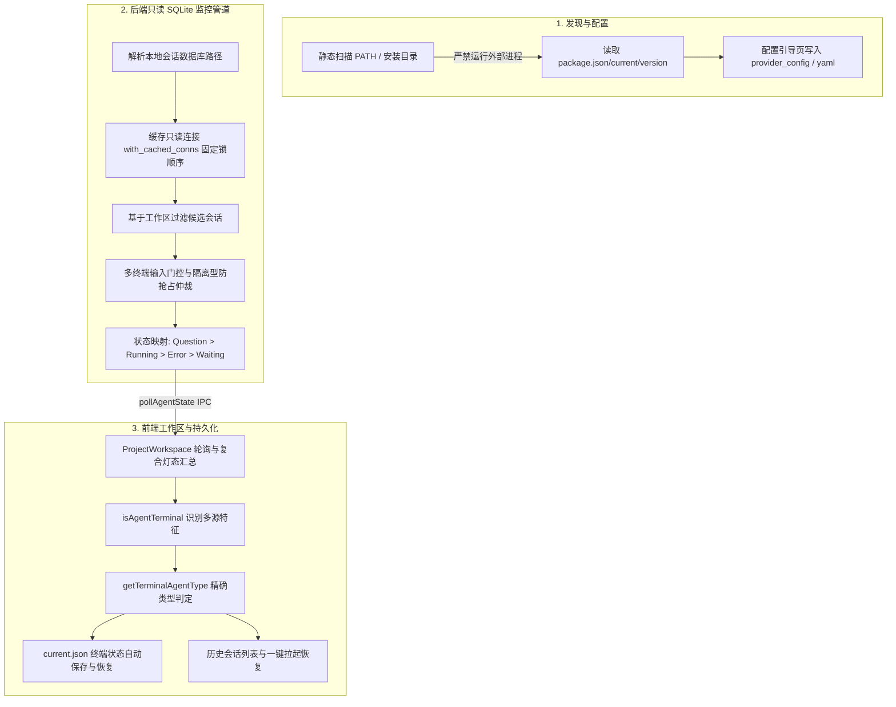

# Loom Agent 接入规范与开发指南 (`agent-adapter`)

本 Skill 旨在规范和指导在 Loom 中新增 CLI Agent（如 opencode、mcode、agy、zcode 等）时的全链路开发。接入任何新 Agent 时，必须严格遵循下述**六大核心切面**与**完整 Checklist**，防止出现终端类型退化、多终端抢占冲突、切换项目状态丢失或启动死锁等隐蔽缺陷。

---

## 一、架构全景与数据流图



---

## 二、全链路开发 Checklist

每次新增或适配新 Agent（假设代号为 `<agent>`）时，必须按顺序检查并完成以下清单：

### 1. 静态发现与版本探测 (`crates/core/src/agent_config.rs`)
> [!CAUTION]
> **安全绝对红线**：严禁对扫描或探测到的 CLI 工具执行任何命令（包括 `--version`、`-v`、`help`）。运行未信任的二进制可能触发勒索、病毒或破坏性脚本。

- [ ] **路径发现**：在 `check_executable` 或通过固定已知安装目录寻找二进制路径。
- [ ] **版本检测**：编写静态版本探测函数 `detect_<agent>_version`，仅通过读取安装目录下的 `package.json`、`current`、`version.txt` 或二进制元数据获取版本。
- [ ] **顺序规范**：更新 `discover_agents()` 列表，并根据项目规划统一 Agent 排序（例如 `mcode` → `zcode` → `agy` → `opencode`）。

### 2. 配置引导与模板自动生成 (`agent_config.rs` & `AgentManagementPage.tsx`)
- [ ] **Provider 配置模型**：在 `agent_config.rs` 实现 `build_<agent>_provider_config` 与 `write_<agent>_config`。
- [ ] **Base URL 规范化**：实现 `normalize_<agent>_base_url`（如去除多余的 `/v1`、`/v1beta`、`/models` 等）。
- [ ] **引导页适配** (`AgentManagementPage.tsx`)：
  - 更新 Agent 切换 Selector 与展示名称、图标。
  - 协议支持矩阵约束（明确其是否支持 Gemini、OpenAI 兼容或 Anthropic 协议）。
  - 保存后自动创建 Loom 运行模板（`Template`），并注入预设的环境变量与执行参数。

### 3. 后端 SQLite 只读监控管道 (`crates/gui/src-tauri/src/agent_monitor.rs`)
- [ ] **数据库路径探测**：
  - 提供 `get_<agent>_db_path() -> Option<PathBuf>`。
  - 优先级：环境变量覆盖优先，其次是 `$USERPROFILE` / `$HOME` 对应运行时目录。
- [ ] **全局只读连接池与死锁防范**：
  > [!IMPORTANT]
  > **固定加锁顺序**：`with_cached_conns` 中获取多个 Agent 的 SQLite Mutex 时，必须严格遵守固定的加锁顺序，绝不可在不同函数中乱序加锁，否则高频并发轮询会导致整个应用无响应死锁。
  - 必须通过 `PRAGMA query_only = ON; PRAGMA busy_timeout = 200;` 以只读连接打开。
- [ ] **会话标识特征判定**：
  - 定义专有会话格式识别（如 mcode 是 `mvs_*`、zcode 是 `sess_*`、agy 是 36 位 UUID、opencode 是 `ses_*`）。各 Agent 会话 ID 必须无冲突。
- [ ] **候选会话查询** (`find_candidate_<agent>_sessions`)：
  - 工作区路径规范化：兼顾 Windows 反斜杠 `\` 与 URI 正斜杠 `/`，统一 `LIKE` 或 `REPLACE` 匹配。
- [ ] **终端仲裁与防抢占**：
  - 在 `poll_state_for_pty_with_conns` 的隔离分支中将新 Agent 纳入 `is_isolated`：
    ```rust
    let is_isolated = matches!(cand_source, SessionSource::Mcode | SessionSource::Agy | SessionSource::Zcode | SessionSource::<Agent>)
        || cand_sid.starts_with("<prefix>_");
    ```
  - 隔离型 Agent 的终端在处于活跃工作状态时，禁止被其他同项目终端抢占。
- [ ] **状态映射与优先级**：
  - 判定顺序：**等待用户提问（Question / 黄灯） > 正在运行（Running / 绿灯） > 报错（Error / 红灯） > 待命（Waiting / 无状态）**。
  - 注意：很多 Agent 阻塞在问卷工具时回合未结束，如果把 Running 放在 Question 前，问卷状态会被吞噬。

### 4. 前端参数清洗与恢复生成 (`crates/gui/frontend/src/utils.ts`)
- [ ] **恢复参数构造器**：实现 `build<Agent>ResumeArgs(args, sessionId)`：
  - 剔除旧的冲突运行参数（例如旧的 `-s`、`--resume`、`--continue`、`-p` 等）。
  - 保留用户自定义的 `--model`、`--mode` 等其它 flag。
  - 注入新会话恢复参数（如 `--session <id>`、`--conversation <id>`、`--resume <id>`）。
- [ ] **单测覆盖** (`crates/gui/frontend/src/test/utils.test.ts`)：
  - 测试新旧参数替换、冲突 flag 清洗、空参数及 undefined 情况。

### 5. 工作区终端状态与持久化 (`crates/gui/frontend/src/pages/ProjectWorkspace.tsx`)
> [!WARNING]
> **最易遗漏的隐蔽缺陷点**：只在单个终端测试灯态往往能跑通，但一旦涉及切换项目或应用重启，缺失持久化分支会导致会话降级丢失。

- [ ] **Agent 终端多维识别 (`isAgentTerminal`)**：
  - 必须同时检查：`isOpencode` 标记、`opencodeSessionId`、`title`、`command`、`initialCommand` 以及 `args`。
- [ ] **Agent 类型判定 (`getTerminalAgentType`)**：
  - 优先按会话 ID 独有特征前缀/格式识别（如 UUID、`sess_`、`mvs_`）；
  - 其次按 `title` / `command` / `initialCommand` / `args` 包含的关键字识别。
- [ ] **`current.json` 自动保存分支**：
  - 终端持久化保存时，必须为新 Agent 分支正确生成 `initCmd`（如 `<agent> --resume ${agentSessionId}`），严禁退化默认走 `opencode`。
- [ ] **`performRestore` 终端重启恢复**：
  - 判定 `is<Agent>`，恢复带对应参数的 `initialCommand` 或通过 `build<Agent>ResumeArgs` 重组 `args`。
- [ ] **历史会话一键恢复**：
  - 列表标签区分 `<agent>`；
  - 单击或右键恢复时，从历史 entry 或模板中继承环境变量，并组装正确的启动命令。

---

## 三、避坑指南 (Gotchas & Antipatterns)

1. **会话数据库只读约束**：
   - Agent 本身频繁写入 SQLite 时，Loom 绝不能加上写锁或独占锁。必须以只读 URI（`SQLITE_OPEN_READ_ONLY`）打开，并设置较低的 `busy_timeout`。
2. **多终端输入门控 (`PTY_LAST_ACTIVE`)**：
   - 后端会根据 PTY 的输入时间与激活序列判断 `can_claim`。前端向后端轮询时，必须尽可能传入准确的 `agent_type`，避免空 agent_type 导致所有 Agent 的 PTY 在同一池子里抢占。
3. **切换项目时的灯态同步**：
   - 切换项目时，`ProjectWorkspace` 组件隐藏（`display: none`），后台轮询仍应维持；但若组件生命周期触发了重新挂载，切记确保持久化文件中已经把会话 ID 正确写下，以便重新恢复时无缝对接状态。
4. **测试要求**：
   - 涉及 Rust 后端修改：必须跑全量 `cargo check --all-targets`、`cargo clippy --all-targets` 和 `cargo test --workspace`。
   - 涉及前端修改：必须跑 `npm run lint` 和 `npm test`。
